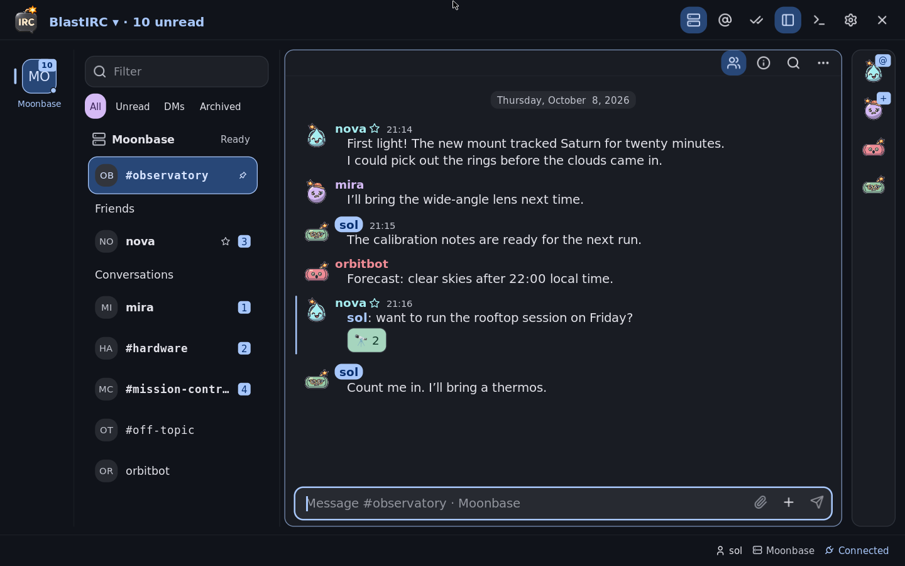
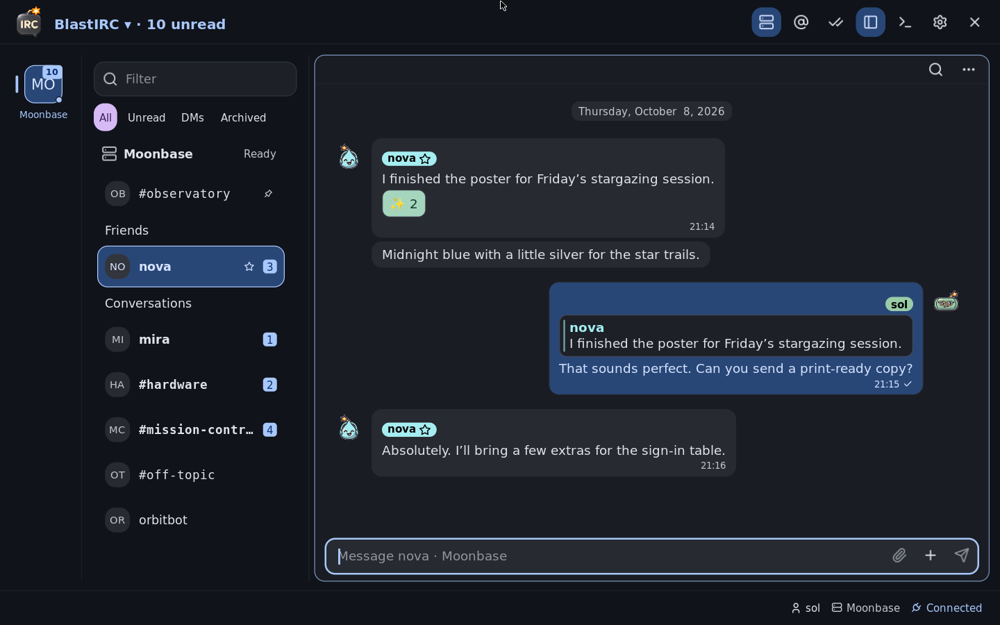
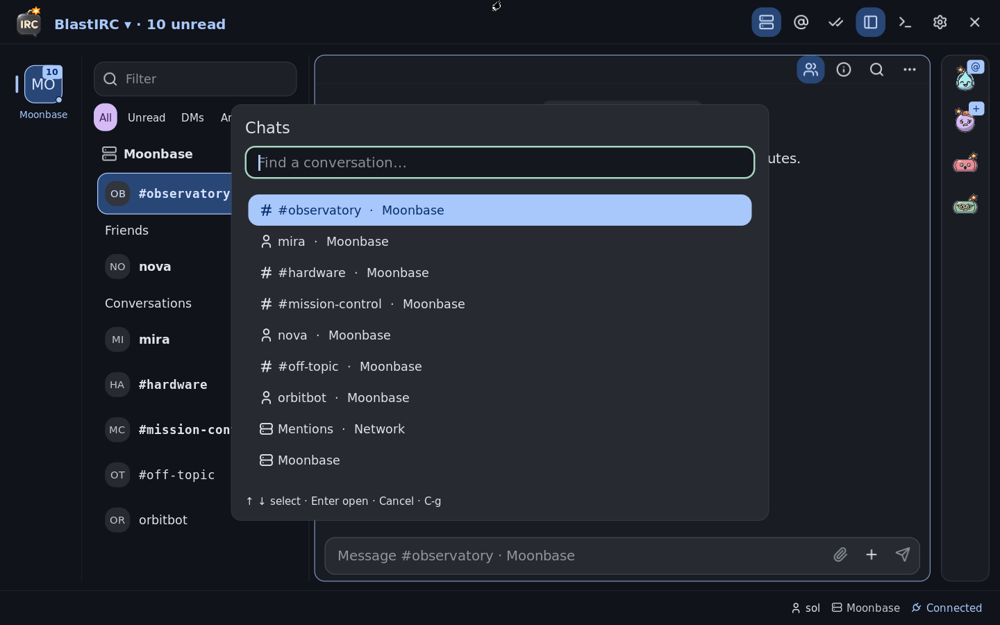

<div align="center"></div>

<div align="center"></div>

# BLAST IRC

A native IRCv3 client for x86_64 Linux and Wayland; X11 and Xwayland are not supported.

## Getting started

From a checkout with Nix:

```sh
nix run .
```

To build separately, use `nix build .#default` and run `./result/bin/blastirc`; for development setup, see [Development and design](UI-DESIGN.md#verification-contract).

Run `nix run .#install-dev` from the checkout root to build the current source and install **BlastIRC (Dev)** in your app launcher. If the build fails, the launcher is left untouched. Opening it later rebuilds only what changed, including uncommitted edits. It shares your BlastIRC settings and history; close the stable instance first. No NixOS rebuild is needed.

On the welcome screen, choose a server and nickname, add any auto-join channels, and select **Save and connect**. TLS is on by default. For a plaintext listener, turn off **TLS** under **Advanced options** and use the listener's port. Plaintext exposes messages and passwords to the network.

For soju, choose **Add soju account** in **Settings → Networks**, enter the bouncer endpoint and base-account identity without a `/network` suffix, then set **Password (SASL PLAIN)** credentials and select **Save and connect**.

If a TLS server or soju bouncer uses a self-signed certificate, choose **Review certificate…** after the connection fails. Confirm the SHA-256 fingerprint with the server administrator before selecting **Trust**. Trust applies only to that hostname, port, and certificate; manage it in the network's settings.

## Features

- Connect directly or through ZNC and soju with TLS, SASL authentication and native soju network management.
- Choose messenger bubbles, adaptive traditional IRC rows or Traditional · two-line with indented message text. Bubbles and two-line group consecutive messages by sender and displayed minute.
- Use keyboard navigation, command and nickname completion, emoji completion and Emacs-style editing. Open **Chats** with `Ctrl+X B`, or cycle through unread channels and DMs with `Ctrl+X Ctrl+Space`.
- Assign shortcuts in **Settings → Keyboard**. New actions start unbound. IRC command shortcuts fill the composer without sending; Undo restores the previous draft.
- Exchange native IRCv3 typing indicators, replies, reactions and read markers, and load history when supported by the server or bouncer.
- Search local history and receive desktop mention notifications.
- Configure independent UI and message fonts and weights, Noctalia colors, scale, transparency, motion and sound.
- Review uploads before sharing links and load link, image and media previews on click by default.

## Screenshots

**Direct messages:** Grouped bubbles, replies, and reactions.



**Chats picker:** Switch between channels and direct messages from the keyboard.



[MIT license](LICENSE) · [Development and design](UI-DESIGN.md)
